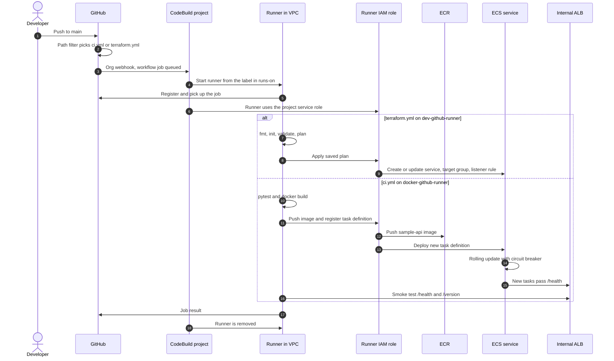

# aws_ecs_api

Sample API: a small FastAPI service on ECS Fargate behind an existing internal ALB at `/sample-api`. Deployed with Terraform and GitHub Actions.

## Run locally

```bash
cd application
pip install -r requirements-dev.txt
pytest
cd .. && docker build -f docker/Dockerfile -t sample-api .
docker run -p 3000:3000 -e ROUTE_PREFIX=/sample-api sample-api
curl localhost:3000/sample-api/health
```

## Deploy

Two workflows run on push to `main`, each only when its own paths change. Pull requests run the same checks without deploying.

| Workflow | Triggers on | Does |
|---|---|---|
| `ci.yml` | `application/**`, `docker/**` | One job: test, build image, push to ECR, deploy to ECS, smoke test |
| `terraform.yml` | `terraform/**` | One job: fmt, init, validate, plan. On push to `main` it also applies that plan |

Each workflow uses one CodeBuild runner and its IAM role, so there are no AWS keys.

### How a push reaches ECS



First time: let `terraform.yml` apply, then run `ci.yml` again (`workflow_dispatch`). The service exists only after the apply, and the first image only after the first CI run.

### Repository variables

| Variable | Used by |
|---|---|
| `GIT_RUNNER` | `terraform.yml`, runner name (`ci.yml` always uses `docker-github-runner`) |
| `SMOKE_TEST_BASE_URL` | `ci.yml` |
| `VPC_ID`, `SUBNET_IDS`, `ECS_CLUSTER_ARN`, `ALB_SECURITY_GROUP_ID`, `ALB_LISTENER_ARN` | `terraform.yml`, existing platform values |

`SUBNET_IDS` is a JSON list, for example `["subnet-a","subnet-b"]`.

### Sample names to replace

| Name in this repo | What it stands for |
|---|---|
| `sample-ecr-repo` | Existing shared ECR repository |
| `sample-cluster` | Existing ECS cluster |
| `sample-terraform-state` | Existing S3 bucket for Terraform state |
| `sample-api` | Service, container and URL prefix |

## Layout

| Path | Purpose |
|---|---|
| `application/` | API code and tests |
| `docker/` | Dockerfile, build from the repo root |
| `terraform/` | Modules and the dev environment |
| `.github/workflows/` | CI and Terraform workflows |
| `docs/architecture.md` | Design decisions and trade-offs |
